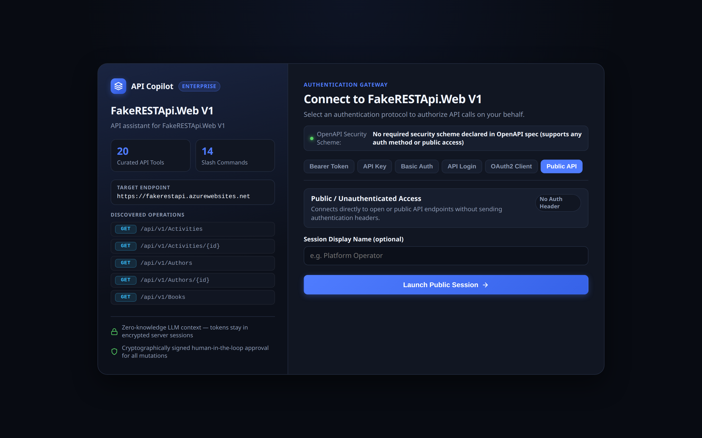
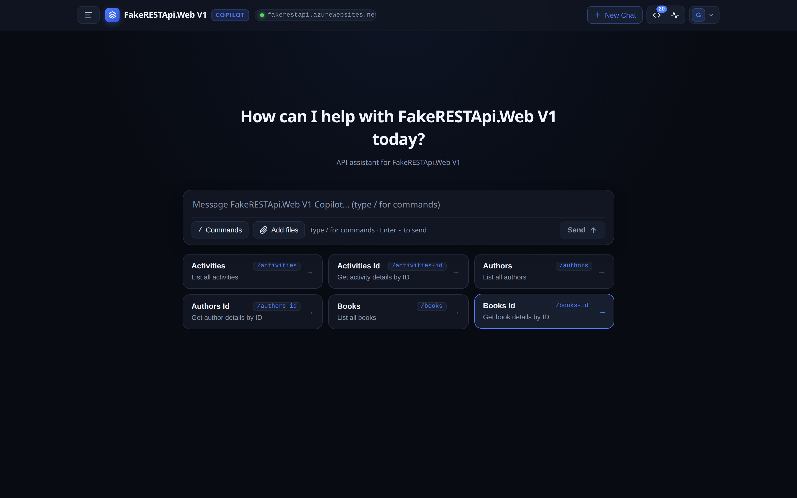
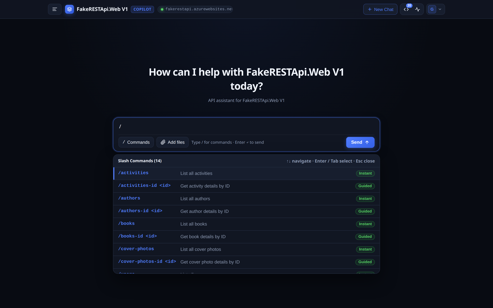
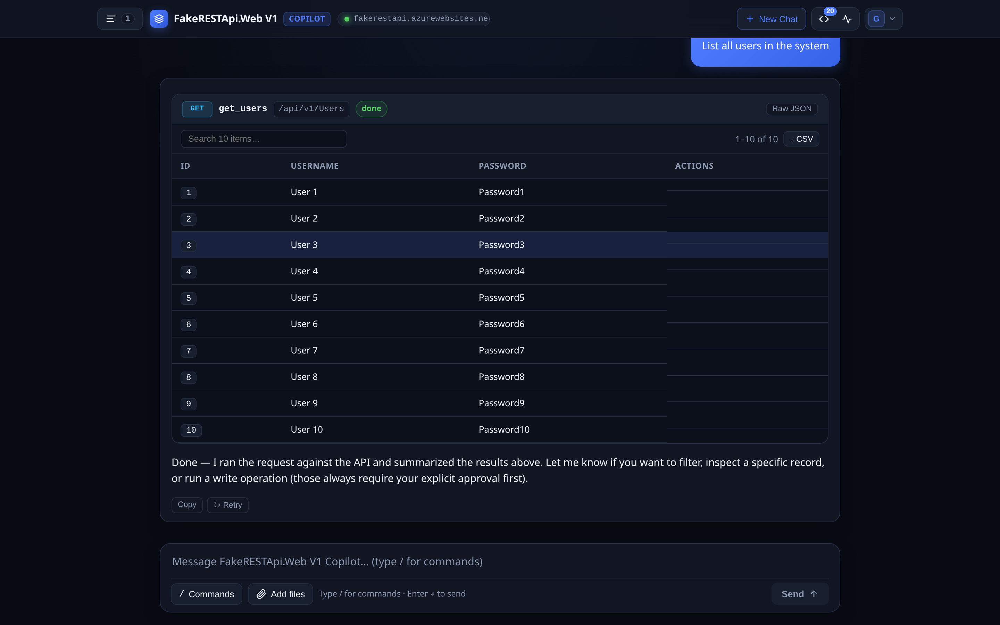
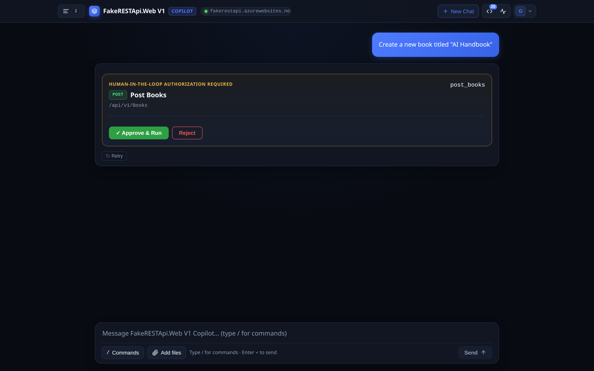

# AI Copilot

<p align="center">
  <strong>Self-configuring, enterprise-grade AI copilot for any REST / OpenAPI service.</strong><br />
  Point it at an OpenAPI spec, pick an LLM, and chat with your API using real-time tool calling and user-isolated credentials.
</p>

<p align="center">
  <a href="https://github.com/the-dave-ops/ai-copilot/actions/workflows/ci.yml"></a>
  <a href="./LICENSE"></a>
  <a href="https://nodejs.org/"></a>
  <a href="https://hub.docker.com/_/redis"></a>
  <a href="./SECURITY.md"></a>
</p>

---

## Overview

**AI Copilot** turns any OpenAPI/Swagger specification into an interactive, ChatGPT-style web workspace with zero manual tool authoring:

1. **Self-Configuring Startup Agent**: On first boot, the agent inspects your API spec (via file path, remote URL, or auto-probing `API_BASE_URL`), curates the **top 15–25 user-facing endpoints**, and writes runtime tools, guided `/` slash commands, starter cards, and a tailored system prompt to `./generated`.
2. **Instant Restarts**: Subsequent starts load `./generated` directly with zero discovery overhead. The agent re-runs automatically only if the target API or spec URL changes.
3. **Multi-Method Auth Gateway**: Users authenticate with **their own permissions** via Bearer Token/PAT, API Key (header or query), HTTP Basic, Direct API Login, OAuth2 Client Credentials, Keycloak/OIDC SSO, or Public/No-Auth.
4. **Cryptographic Human-in-the-Loop**: Mutating operations (`POST`, `PUT`, `PATCH`, `DELETE`) require explicit user confirmation via an HMAC-signed approval card before any HTTP request leaves the server.
5. **Zero Token Leakage**: Credentials live strictly in server-side Redis sessions — they are never passed to the LLM, exposed to the browser, or written to logs.

---

## Screenshots

<p align="center">
  <strong>1. Authentication Gateway</strong><br />
  <em>Auto-detects supported auth schemes from OpenAPI; supports Bearer, API Key, Basic, OAuth2, OIDC, and Public access.</em>
</p>

<p align="center">
  
</p>

---

<p align="center">
  <strong>2. Interactive Workspace & Starter Cards</strong><br />
  <em>Curated starter cards derived from top API endpoints for one-click common operations.</em>
</p>

<p align="center">
  
</p>

---

<p align="center">
  <strong>3. Guided Slash Command Menu</strong><br />
  <em>Type <code>/</code> to access instant commands and guided parameter forms generated directly from the OpenAPI catalog.</em>
</p>

<p align="center">
  
</p>

---

<p align="center">
  <strong>4. Dynamic Tool Execution & Rich Tabular View</strong><br />
  <em>Read tools execute automatically with sorting, pagination, search, and CSV export.</em>
</p>

<p align="center">
  
</p>

---

<p align="center">
  <strong>5. Cryptographically Signed Human-in-the-Loop Approval</strong><br />
  <em>Mutating operations require explicit user approval with field inspection and override capabilities.</em>
</p>

<p align="center">
  
</p>

---

## Architecture

```
Browser (React + Vite Chat UI)
  │
  ├─ HttpOnly, Secure, SameSite=Lax Cookie
  ▼
NestJS Agent Service (Node.js 22)
  ├─ StartupAgentService    ── Inspects OpenAPI spec -> generates tools into ./generated
  ├─ AuthModule             ── Bearer, API Key, Basic, API Login, OAuth2, OIDC, Public
  ├─ ChatModule             ── POST /api/chat (streaming UI message protocol)
  ├─ ToolsModule            ── Dynamic Zod registry + Human-in-the-Loop executor
  ├─ ApiClientModule        ── Per-call auth injection & timeout control
  └─ LlmModule              ── OpenAI-compatible provider (OpenAI, OpenRouter, Ollama, etc.)
        │                           │
        ▼                           ▼
  Target REST API              Redis (sessions, threads, audit log)
```

---

## Security Model

See [SECURITY.md](./SECURITY.md) and [docs/security.md](./docs/security.md) for full details:

- **Zero Token Leakage**: User tokens never enter LLM prompt context or browser payloads.
- **Signed Approvals**: Write operations require user confirmation; approvals are signed with `SESSION_SECRET` and bound to the user session.
- **SSRF & CSRF Protection**: Strict origin verification on API login routes, private network blocks on OAuth2 token endpoints, and same-origin validation on mutating actions.
- **Tenant Isolation**: Conversations and audit trails are partitioned per credential hash in Redis.

---

## Quick Start (Docker Compose)

The fastest way to run AI Copilot with Redis and the public FakeRESTApi:

```bash
# 1. Clone repository
git clone https://github.com/the-dave-ops/ai-copilot.git
cd ai-copilot

# 2. Configure environment
cp .env.example .env

# Edit .env and set your LLM API key:
# LLM_API_KEY=sk-...

# 3. Launch stack
docker compose up --build
```

Open `http://localhost:3000` in your browser. Select **Public API** to start exploring immediately.

---

## Local Development

```bash
# 1. Start Redis
docker compose up -d redis

# 2. Install all dependencies (root, server, web)
npm install && npm run install:all

# 3. Configure environment
cp .env.example .env
# Set LLM_API_KEY and SESSION_SECRET=$(openssl rand -hex 32)

# 4. Build frontend and backend
npm run build

# 5. Start server
npm start
```

For hot-reloading during development:

```bash
npm run dev       # NestJS backend on :3000
npm run dev:web   # Vite frontend on :5173
```

---

## Connecting Your Own API

Set the following variables in `.env`:

| Variable | Description | Default |
|---|---|---|
| `API_BASE_URL` | Root URL of the target API (e.g. `https://api.example.com`) | `https://fakerestapi.azurewebsites.net` |
| `OPENAPI_SPEC_URL` | *(Optional)* Direct URL to OpenAPI/Swagger JSON or YAML | Auto-probes `API_BASE_URL` |
| `OPENAPI_SPEC_PATH` | *(Optional)* Local file path to an OpenAPI `.yaml` or `.json` file | — |
| `TOOLS_DATA_DIR` | Directory where generated tools & slash commands are saved | `./generated` |
| `STARTUP_AGENT_ENABLED` | Run discovery agent on first boot | `true` |
| `FORCE_REGENERATE_TOOLS` | Force re-running discovery on next startup | `false` |
| `STARTUP_AGENT_MIN_ENDPOINTS` | Minimum endpoints selected by discovery agent | `15` |
| `STARTUP_AGENT_MAX_ENDPOINTS` | Maximum endpoints selected by discovery agent | `25` |

### What Gets Generated in `TOOLS_DATA_DIR` (`./generated`)

- `api-config.json`: Metadata, detected auth schemes, tool catalog, slash commands, and starter cards.
- `tools.json`: Declarative tool specifications with JSON Schema validation.
- `slash-commands.json`: `/` slash commands and starter card configurations.
- `system-prompt.txt`: Tailored system prompt for the LLM.

---

## Supported Authentication Methods

When connecting to the target API, users can choose:

1. **Bearer Token / JWT (`bearer`)**: Sends `Authorization: Bearer <token>`
2. **API Key (`api_key`)**: Custom header (e.g. `X-API-Key`) or query parameter (`?api_key=...`)
3. **HTTP Basic Auth (`basic`)**: Sends `Authorization: Basic base64(username:password)`
4. **API Login Endpoint (`api_login`)**: POSTs credentials to API login route and extracts session token
5. **OAuth2 Client Credentials (`oauth2_client_credentials`)**: Server-managed token exchange and auto-refresh
6. **Single Sign-On / OIDC (`oidc`)**: PKCE Authorization Code flow with Keycloak or any OIDC provider
7. **Public / No Auth (`none`)**: Direct access for public APIs without auth headers

---

## Switching LLM Providers

AI Copilot works with any OpenAI-compatible chat completions endpoint. Configure in `.env`:

```env
# OpenAI
LLM_BASE_URL=https://api.openai.com/v1
LLM_API_KEY=sk-...
LLM_MODEL=gpt-4o

# OpenRouter
LLM_BASE_URL=https://openrouter.ai/api/v1
LLM_API_KEY=sk-or-...
LLM_MODEL=anthropic/claude-3.5-sonnet

# Local Ollama
LLM_BASE_URL=http://localhost:11434/v1
LLM_API_KEY=ollama
LLM_MODEL=llama3.1
```

---

## Kubernetes Deployment

### Option 1: Helm Chart (`helm/api-copilot`)

```bash
helm install ai-copilot ./helm/api-copilot \
  --namespace ai-copilot --create-namespace \
  --set image.repository=ghcr.io/the-dave-ops/ai-copilot \
  --set image.tag=latest \
  --set config.appBaseUrl=https://copilot.example.com \
  --set config.apiBaseUrl=https://api.example.com \
  --set config.openApiSpecUrl=https://api.example.com/openapi.json \
  --set config.redisUrl=redis://redis.ai-copilot.svc:6379 \
  --set config.llmBaseUrl=https://api.openai.com/v1 \
  --set config.llmModel=gpt-4o \
  --set secrets.sessionSecret=$(openssl rand -hex 32) \
  --set secrets.llmApiKey=sk-...
```

### Option 2: Raw Manifests (`k8s/`)

1. Update `k8s/01-configmap.yaml`, `k8s/02-secret.yaml`, and `k8s/05-ingress.yaml`.
2. Apply:

```bash
kubectl apply -f k8s/00-namespace.yaml
kubectl apply -f k8s/01-configmap.yaml
kubectl apply -f k8s/02-secret.yaml
kubectl apply -f k8s/03-deployment.yaml
kubectl apply -f k8s/04-service.yaml
kubectl apply -f k8s/05-ingress.yaml
```

---

## Capturing Documentation Screenshots

The repository includes an automated screenshot capture script using headless Chrome:

```bash
# Ensure the app is running on :3000
APP_URL=http://localhost:3000 node scripts/capture-screenshots.mjs
```

Screenshots are refreshed directly into `docs/screenshots/`.

---

## Testing

```bash
npm test            # Unit tests + e2e test suite
npm run build       # Verify full build
```

---

## Community & Contributing

We welcome contributions of all kinds! Please read our [CONTRIBUTING.md](./CONTRIBUTING.md) guide before submitting pull requests.

- **Found a bug?** Open an issue using the [Bug Report template](https://github.com/the-dave-ops/ai-copilot/issues/new?template=bug_report.yml).
- **Have an idea?** Suggest an enhancement via [Feature Request](https://github.com/the-dave-ops/ai-copilot/issues/new?template=feature_request.yml).
- **Security issue?** Follow our confidential [Security Policy](./SECURITY.md).

---

## License

[MIT License](./LICENSE) © 2026 AI Copilot Contributors.

